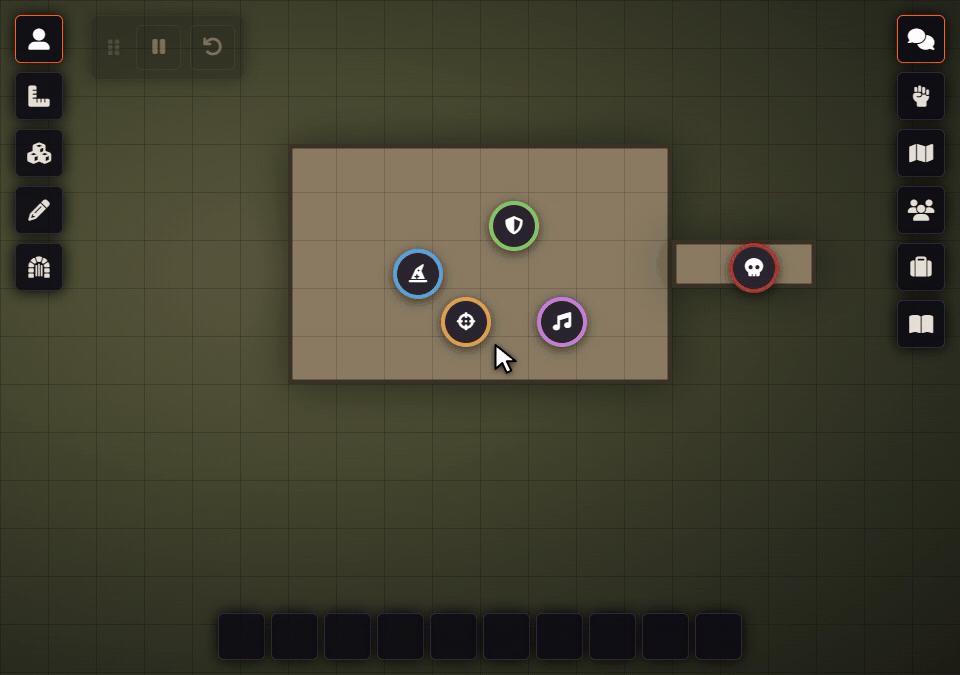

# Player Spotlight Timer

**Never lose a player in the shadows again.**

Some players speak up, others wait patiently, and in the heat of a session it is easy to miss that someone hasn't had a moment in an hour. Player Spotlight Timer quietly keeps count for you: a small GM-only widget that tracks how long each player has gone without the spotlight, and only steps forward when someone needs your attention.



## Features

- **Stays out of your way.** While everyone is fine, the widget fades to a faint outline. Hover over it to see every player's clock.
- **Speaks up when it matters.** Once a player passes the warning time, their name appears on its own in yellow. At the maximum it turns red and the widget pulses gently.
- **One click per spotlight.** Gave Mara her moment? Click her name and her clock starts over.
- **Pause and reset.** Pause all clocks during breaks, or reset everyone at the start of a scene.
- **Put it where you want it.** Drag it anywhere and pin it in place, have player names grow left or right and above or below, or dock it as a single icon in the scene controls or the sidebar.
- **Survives reloads.** Clocks keep running across a page refresh.
- **Only for the GM.** Players never see it, and only connected players are counted.

## Installation

In Foundry VTT, open **Add-on Modules → Install Module**, paste this manifest URL into the field at the bottom and click **Install**:

```
https://github.com/Rhapsody-Sky/FoundryVTT-Player-Spotlight-Timer/releases/latest/download/module.json
```

Then enable **Player Spotlight Timer** under **Manage Modules** in your world.

## Usage

| Control | What it does |
|---|---|
| <kbd>▶</kbd> / <kbd>⏸</kbd> | Start or pause all player clocks |
| <kbd>↺</kbd> | Reset all player clocks |
| Player name | Reset that player's clock after they had the spotlight |
| Grip (drag) | Move the widget |
| Pin | Lock the widget in place |
| Dock | Collapse the widget into an icon in the scene controls or sidebar |
| Gear | Warning time, maximum time, layout and dock position |

Warning time (default 10 min) and maximum time (default 20 min) can also be changed under **Configure Settings → Player Spotlight Timer**, along with how faint the widget is while idle.

## Compatibility

| Foundry VTT | Status |
|---|---|
| V14 | ✅ Verified |
| V13 | ✅ Supported |

Works with any game system.

## Languages

English · Deutsch · Español · Français · 日本語 · 中文（简体）

Spotted a translation that could be better? Open an [issue](https://github.com/Rhapsody-Sky/FoundryVTT-Player-Spotlight-Timer/issues).

## License

[MIT](LICENSE)
